<!--
SPDX-FileCopyrightText: 2026 Paolo Sereno <pablitos1024@gmail.com>

SPDX-License-Identifier: MIT
-->

# QtIndustrialWidgets

A C++17 widget library for Qt Widgets with 12 instrumentation widgets — gauges, displays, indicators, switches, an
alarm annunciator, a live strip chart and an offline analysis chart — for test benches, SCADA and telemetry
applications.

[](https://en.cppreference.com/w/cpp/17)
[](https://www.qt.io/)
[](.github/workflows/ci.yml)
[](https://github.com/paolosereno/QtIndustrialWidgets/actions/workflows/ci.yml)
[](LICENSE)
[](https://api.reuse.software/info/github.com/paolosereno/QtIndustrialWidgets)
[](https://paolosereno.github.io/QtIndustrialWidgets/)

<p align="center">
  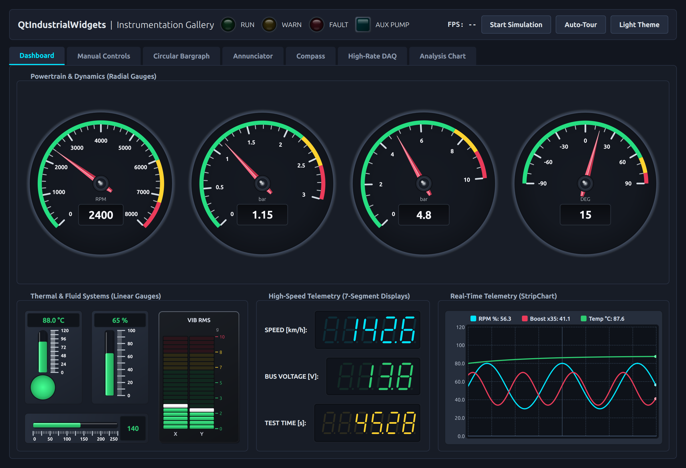
</p>

## Widgets

| Widget | Showcase |
|---|---|
| [`RadialGauge`](docs/widgets.md#radialgauge)<br>0–8000 RPM, needle in the warning zone | 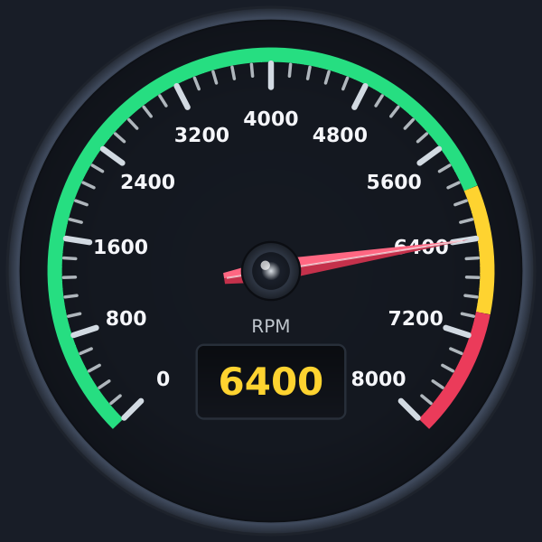 |
| [`LinearGauge`](docs/widgets.md#lineargauge)<br>Thermometer mode, 0–120 °C | 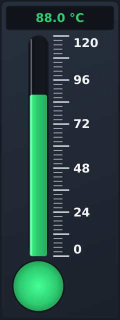 |
| [`SevenSegmentDisplay`](docs/widgets.md#sevensegmentdisplay)<br>Six digits, one decimal, skewed segments |  |
| [`LedIndicator`](docs/widgets.md#ledindicator)<br>Round lens, on, with label |  |
| [`IndustrialKnob`](docs/widgets.md#industrialknob)<br>Continuous 0–8000 RPM with value pod | 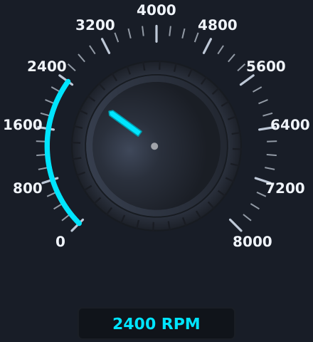 |
| [`StripChart`](docs/widgets.md#stripchart)<br>Three channels over 10 s with a NaN dropout | 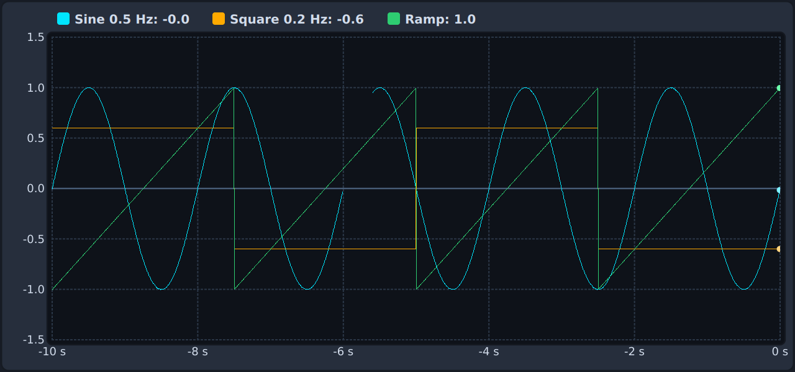 |
| [`IndustrialSwitch`](docs/widgets.md#industrialswitch)<br>Toggle lever under a safety guard | 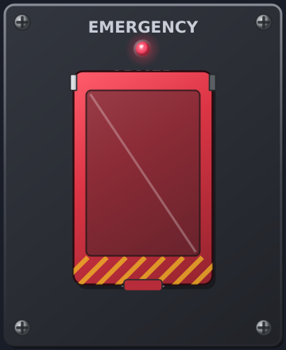 |
| [`LevelMeter`](docs/widgets.md#levelmeter)<br>Stereo dB meter with held peaks | 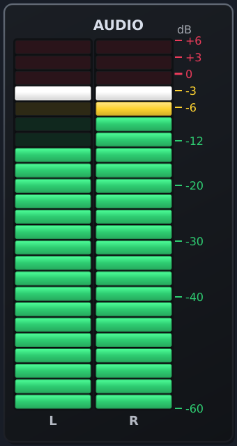 |
| [`AnnunciatorPanel`](docs/widgets.md#annunciatorpanel)<br>ISA-18.1 tiles: acknowledged, unacknowledged and advisory alarms | 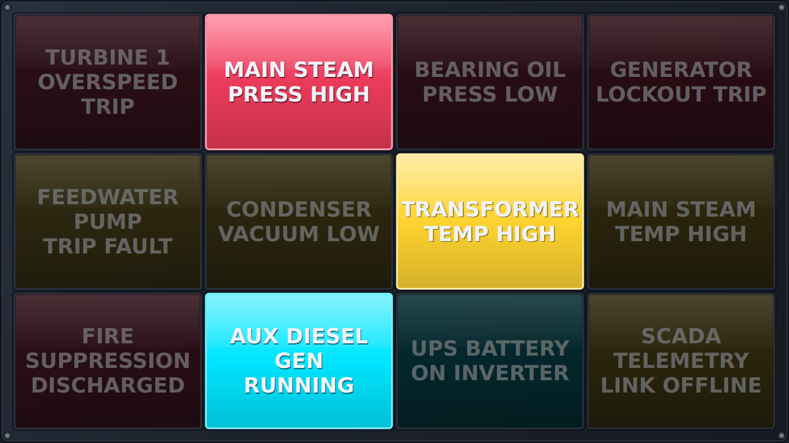 |
| [`Compass`](docs/widgets.md#compass)<br>Heading-up card, heading 047° with heading bug | 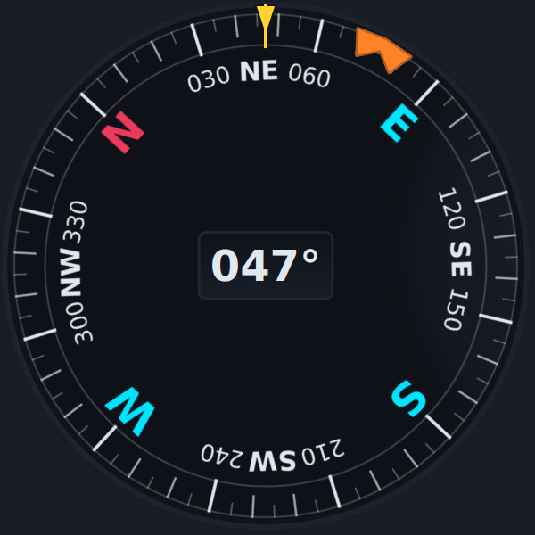 |
| [`CircularBargraph`](docs/widgets.md#circularbargraph)<br>24 segments with peak hold | 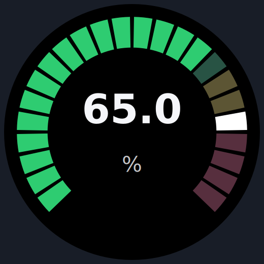 |
| [`AnalysisChart`](docs/widgets.md#analysischart)<br>Recorded data at two rates, a NaN dropout and a recording gap | 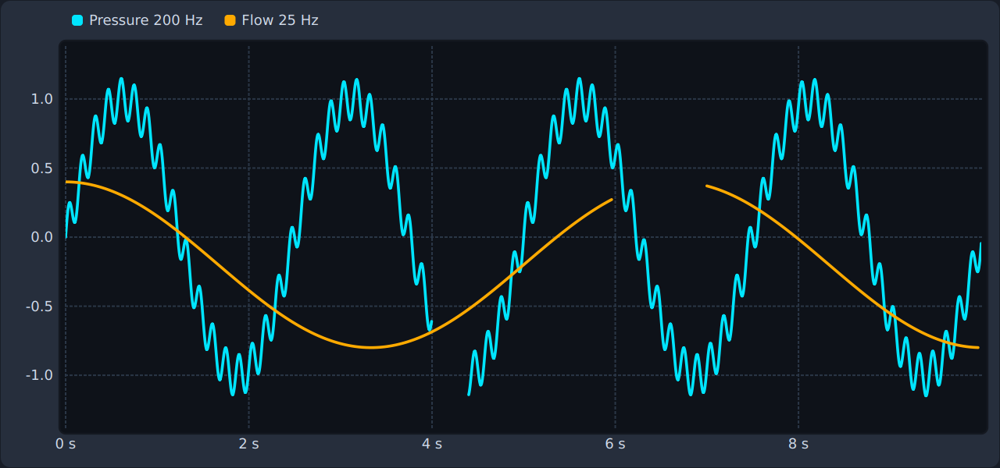 |

The images are generated by the gallery with `--export-gallery` (dark theme, device pixel ratio 2, shown at half their
pixel width); see [docs/gallery_images.md](docs/gallery_images.md). Each widget's features are described in
[docs/widgets.md](docs/widgets.md).

## Quick start

```cmake
include(FetchContent)

FetchContent_Declare(
    QtIndustrialWidgets
    GIT_REPOSITORY https://github.com/paolosereno/QtIndustrialWidgets.git
    GIT_TAG        v2.5.1
)
set(BUILD_EXAMPLES OFF CACHE BOOL "" FORCE)
set(BUILD_DESIGNER_PLUGIN OFF CACHE BOOL "" FORCE)
FetchContent_MakeAvailable(QtIndustrialWidgets)

target_link_libraries(my_app PRIVATE QtIndustrialWidgets::QtIndustrialWidgets)
```

```cpp
#include <QtIndustrialWidgets/RadialGauge.h>
#include <QtIndustrialWidgets/LinearGauge.h>
#include <QtIndustrialWidgets/SevenSegmentDisplay.h>

// Inside a QWidget-derived class. 'qiw' is the short alias of namespace QtIndustrialWidgets.

auto *rpmGauge = new qiw::RadialGauge(this);
rpmGauge->setRange(0.0, 8000.0);
rpmGauge->setValue(3500.0);
rpmGauge->setUnit("RPM");
rpmGauge->setWarningThreshold(6000.0);
rpmGauge->setErrorThreshold(7200.0);

auto *coolant = new qiw::LinearGauge(this);
coolant->setThermometerMode(true);
coolant->setRange(0.0, 120.0);
coolant->setValue(90.0);
coolant->setUnit("°C");

auto *speedometer = new qiw::SevenSegmentDisplay(this);
speedometer->setDigitCount(5);
speedometer->setDecimalPlaces(1);
speedometer->setValue(120.4);
speedometer->setActiveSegmentColor(QColor(0, 229, 255));
```

## How it is verified

- **Tests**: a QtTest suite; every test program runs at device pixel ratios 1, 1.25, 1.5 and 2
  ([tests/CMakeLists.txt](tests/CMakeLists.txt)). Rendering is checked at pixel level (traces, gaps, labels, layout),
  and new tests are shown to fail under a deliberate sabotage of the feature they cover before they are merged; the
  results are reported in each pull request
  ([CONTRIBUTING.md](https://github.com/paolosereno/QtIndustrialWidgets/blob/main/CONTRIBUTING.md)).
- **CI** ([ci.yml](.github/workflows/ci.yml)), on every pull request and push to `main`: build and the full test
  suite on Linux (Ubuntu 24.04, GCC, Qt 6.4.2 and Qt 6.2.4), Windows (MSVC, Qt 6.6.3) and macOS (Apple Clang, Homebrew Qt);
  `reuse lint`; on Linux, the export of the gallery images and the Doxygen documentation.
- **Benchmarks**: method, machine, command lines and raw tables in [docs/benchmarks.md](docs/benchmarks.md),
  including the targets that are not met.
- **Images**: the documentation images are generated by the gallery and are byte-identical for the same commit,
  platform and options ([docs/gallery_images.md](docs/gallery_images.md)).
- **Releases** ([release.yml](.github/workflows/release.yml)): a Debian package, a Linux `.tar.gz`, a Windows `.zip`
  and an SPDX SBOM are attached to each GitHub release (see
  [v2.3.0](https://github.com/paolosereno/QtIndustrialWidgets/releases/tag/v2.3.0)).
- **Licensing**: REUSE compliant; `reuse lint` runs in CI.
- **Dependencies**: none beyond Qt. The library links only Qt `Core`, `Gui` and `Widgets`; the Qt Designer plugin is
  a separate module that also needs Qt `Designer`.

## Integration

**Requirements**: CMake 3.16 or newer, a C++17 compiler and Qt 6.2 or newer, required by CMake (CI builds with Qt 6.2.4,
6.4.2, 6.6.3 and Homebrew's current Qt). Qt 5 is not supported; the minimum is Qt 6.2 (see
[#53](https://github.com/paolosereno/QtIndustrialWidgets/issues/53)).

- **FetchContent**: see Quick start above.
- **Build and install**, then `find_package()`:
  ```bash
  cmake -B build -DCMAKE_BUILD_TYPE=Release
  cmake --build build
  ctest --test-dir build --output-on-failure
  cmake --install build --prefix /opt/QtIndustrialWidgets
  ```
  ```cmake
  find_package(QtIndustrialWidgets REQUIRED)
  target_link_libraries(my_app PRIVATE QtIndustrialWidgets::QtIndustrialWidgets)
  ```
- **Prebuilt packages** from [GitHub Releases](https://github.com/paolosereno/QtIndustrialWidgets/releases):
  `sudo dpkg -i qtindustrialwidgets_<version>_amd64.deb` on Ubuntu 24.04, or extract the `.tar.gz` (Linux, built
  and checked on Ubuntu 24.04) / `.zip` (Windows) and add the extracted directory to `CMAKE_PREFIX_PATH`.
- **vcpkg**: from the registry [paolosereno/vcpkg-registry](https://github.com/paolosereno/vcpkg-registry), with
  `"qtindustrialwidgets"` in your `vcpkg.json` and the registry in your `vcpkg-configuration.json` (see
  [Getting started](docs/getting_started.md)); or, from a clone of this repository, as an overlay port:
  `vcpkg install --overlay-ports=./ports/qtindustrialwidgets qtindustrialwidgets`. Both are verified by the
  packaging workflow ([packaging.yml](.github/workflows/packaging.yml)) on Linux (x64-linux-release), Windows
  (x64-windows-static-md-release, x64-windows-release) and macOS (arm64-osx-release).
- **Conan 2**: `conan install . --lockfile=conan.lock --build=missing` (the recipe is [conanfile.py](conanfile.py);
  [conan.lock](conan.lock) pins Qt and its dependencies to ConanCenter's prebuilt binaries). The recipe is verified on
  Linux, Windows and macOS by the packaging workflow ([packaging.yml](.github/workflows/packaging.yml)): a static library with Qt from
  ConanCenter, checked by the consumer in [test_package/](test_package/). Linking Qt statically has additional
  obligations under the LGPL (for example, allowing users to relink the application with a modified Qt); check
  [Qt's licensing terms](https://www.qt.io/licensing/) for how you distribute your application.

The interactive gallery is built by default (`BUILD_EXAMPLES`): `./build/bin/QtIndustrialWidgetsGallery`.

## Qt Designer

With `BUILD_DESIGNER_PLUGIN` (on by default, switched off when Qt `Designer` is not found), the plugin
`QtIndustrialWidgetsPlugin` registers the 12 widgets in the **Industrial Widgets** category of Qt Designer and Qt
Creator. Installation: [docs/designer_plugin.md](docs/designer_plugin.md).

## Documentation

API reference and guides on GitHub Pages: <https://paolosereno.github.io/QtIndustrialWidgets/>

- **[Widgets](docs/widgets.md)**: the features of each widget.
- **[Getting Started](docs/getting_started.md)**: `FetchContent`, `find_package` and standalone integration.
- **[Theming](docs/theming.md)**: each widget has its own colour properties; the gallery sets them for a light and a
  dark theme.
- **[Qt Designer plugin](docs/designer_plugin.md)**: building and installing the plugin.
- **[StripChart](docs/strip_chart.md)** and **[AnalysisChart](docs/analysis_chart.md)**: guides of the two charts.
- **[Benchmark Report](docs/benchmarks.md)** and **[Documentation images](docs/gallery_images.md)**.

To build the documentation locally (needs Doxygen; Graphviz is optional): `cmake --build build --target docs`, output
in `build/docs/html/index.html`. Without a CMake build, from the project root:
```bash
mkdir -p build/docs   # Doxygen creates only the last folder of OUTPUT_DIRECTORY
QIW_VERSION=$(sed -n 's/^ *VERSION \([0-9][0-9.]*\) *$/\1/p' CMakeLists.txt | head -n1) doxygen docs/Doxyfile
```

## Contributing

How changes are made and what a pull request has to show (tests first for bugs, sabotage checks for new tests, the
criteria for "done", Conventional Commits):
[CONTRIBUTING.md](https://github.com/paolosereno/QtIndustrialWidgets/blob/main/CONTRIBUTING.md). Taking part in the project means
following the [Code of Conduct](https://github.com/paolosereno/QtIndustrialWidgets/blob/main/CODE_OF_CONDUCT.md)
(Contributor Covenant 2.1).

## License

[MIT](LICENSE) (SPDX: `MIT`, full text in [LICENSES/MIT.txt](LICENSES/MIT.txt)). Every file carries SPDX copyright
and license information, as the [REUSE specification](https://reuse.software/) requires; `reuse lint` checks it in CI.
