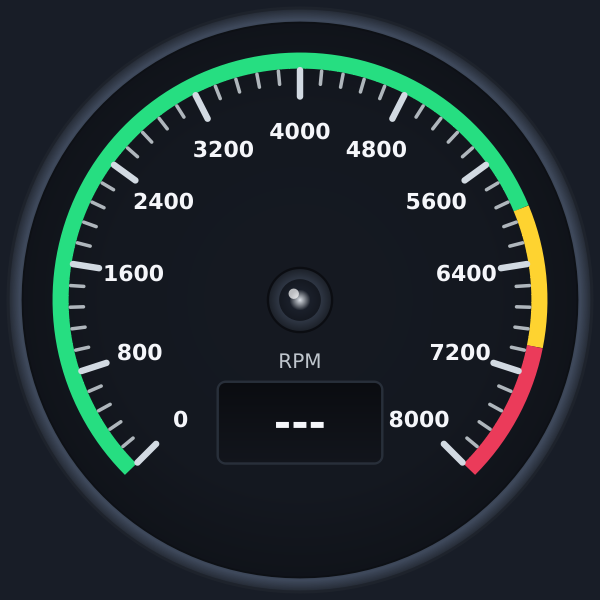
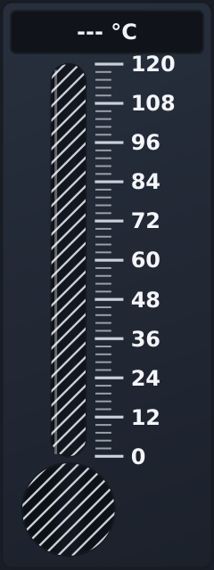

<!--
SPDX-FileCopyrightText: 2026 Paolo Sereno <pablitos1024@gmail.com>

SPDX-License-Identifier: MIT
-->

# Widgets {#widgets}

One section per widget: what it shows, its main properties and how it is driven. All classes live in namespace
`QtIndustrialWidgets` (short alias `qiw`). The images are the gallery showcases (`--export-gallery`, dark theme, see
[gallery_images.md](gallery_images.md)). The colour properties of each widget are listed in [theming.md](theming.md);
the complete API is in the class documentation.

**Readout of the value states** (#151), the same for `RadialGauge`, `LinearGauge` and `CircularBargraph` (#167):
- an invalid (NaN) input reads `---`;
- an input outside the range reads the input itself, or `>max` / `<min` for ±Inf, after a triangle pointing up or
  down, painted as a shape (it does not depend on the installed fonts); the text is made smaller, if needed, to fit
  the display;
- the unit is shown in every state where it is shown for a valid value: `RadialGauge` keeps its unit label on the
  dial, the vertical `LinearGauge` display keeps the unit after the readout (`--- °C`, `▲ 135.4 °C`). The
  horizontal `LinearGauge` display shows no unit, in any state. `CircularBargraph` keeps the text at 7 pt or more
  and, when the pod is too small, leaves out the unit, then the number, never `---` or the triangle (see its
  section).

**Readout colours** (#159): the readout pods of `RadialGauge`, `LinearGauge`, `Compass` and `IndustrialKnob` are
opaque and dark in every theme. Their readout is drawn in `readoutColor` (`RadialGauge`: normal zone and `---`;
`LinearGauge`: `---`; `Compass`: always), or in the colour of its zone, never in `textColor`, which colours the scale
labels and is dark in a light theme. `IndustrialKnob` draws its readout in `pointerColor`; the `CircularBargraph` pod
follows `dialColor` and its readout `textColor`. With the default readout and zone colours, in the gallery's dark and
light styling, every readout state has a contrast of at least 4.5:1 (WCAG 2.x) against its pod
(`tests/tst_ReadoutContrast.cpp`).

## RadialGauge

Circular gauge for speed, pressure, temperature and similar values (`qiw::RadialGauge`).
- **Sweep**: `startAngle` and `spanAngle` set the arc, for example 270°, 240° or 180°.
- **Scale**: `majorTicks` and `minorTicks`, with numeric labels at the major ticks.
- **Thresholds**: `warningThreshold` and `errorThreshold`, shown as coloured arc bands (`thresholdBandsVisible`);
  `warningExceeded(bool)` and `errorExceeded(bool)` report crossings.
- **Digital display**: optional (`digitalDisplayVisible`), with `precision` and `unit`; it is sized and placed clear
  of the scale labels.
- **Rendering**: the static scale is cached in a pixmap and rebuilt on geometry or appearance changes; a value change
  redraws the needle and the display.
- **Value state** (#151): `valueState()` reports `Valid`, `Underrange`, `Overrange` or `Invalid` (the
  `QtIndustrialWidgets::ValueState` enum), with `valueStateChanged()`; `rawValue()` keeps the unclamped input, and a
  range change classifies it again. Before the first `setValue()` there is no input: the initial value (0) follows
  the range, so a range that does not hold 0 shows its minimum, in the `Valid` state.
  - An input outside the range (finite or ±Inf) puts the needle at the stop and `value()` at the bound. The display
    shows the input itself (for example `8350` on a 0–8000 scale), or `>max` / `<min` for ±Inf, after a triangle
    pointing up (above the range) or down (below it), so the state is not shown by colour alone.
  - A NaN input is `Invalid`: no needle, display `---`, `value()` NaN. The last valid value is not shown, and
    `warningExceeded()` / `errorExceeded()` are not emitted for an invalid input: use `valueStateChanged()` to
    detect it.

## LinearGauge

Bar gauge and thermometer (`qiw::LinearGauge`).
- **Orientation**: `Qt::Vertical` or `Qt::Horizontal`.
- **Thermometer mode** (`thermometerMode`): a bulb at the bottom (vertical) or on the left (horizontal); otherwise a
  plain bar.
- **Liquid colour**: fixed (`liquidColor`), following the warning and error thresholds (`dynamicLiquidColor`), or a
  gradient fill (`gradientLiquid`).
- **Scale and display**: major and minor ticks with labels (`scaleVisible`), optional digital display with `precision`
  and `unit`.
- **Value state** (#151): `valueState()` reports `Valid`, `Underrange`, `Overrange` or `Invalid`, with
  `valueStateChanged()`; `rawValue()` keeps the unclamped input, and a range change classifies it again. Before the
  first `setValue()` the initial value (0) follows the range, as in `RadialGauge`.
  - An input outside the range (finite or ±Inf) fills the tube to its end and puts `value()` at the bound. The
    display shows the input itself (for example `135.4 °C` on a 0–120 scale), or `>max` / `<min` for ±Inf, after a
    triangle pointing up (above the range) or down (below it), so the state is not shown by colour alone.
  - A NaN input is `Invalid`: the tube and the bulb are empty and hatched with diagonal lines in `scaleColor`, the
    display shows `---` and `value()` is NaN. The last valid value is not shown.

## SevenSegmentDisplay

Vector seven-segment display for numeric readouts (`qiw::SevenSegmentDisplay`).
- **Vector segments**: the segments are painted as polygons and scale with the widget.
- **Format**: `digitCount`, `decimalPlaces`, `showLeadingZeros`, `showDecimalPoint`; a value that rounds to zero is
  shown without a minus sign.
- **Shape**: `skewAngle` (italic slant) and `segmentWidthRatio` (segment thickness).
- **Colours**: `activeSegmentColor` for lit segments and `inactiveSegmentColor` for unlit ones.
- **Text** (`setText()`): digits, `-`, `_`, `=`, space and the letter patterns A, b, C, c, d, E, F, H, L, o, P, r, U.
  Upper- and lower-case input give the same pattern, except `C`/`c` (two patterns) and `r` (lower case only); any
  other character is shown blank.

## LedIndicator

LED indicator lamp (`qiw::LedIndicator`).
- **Shape**: `LedShape::Circular` or `LedShape::Rectangular`, with an optional bezel (`bezelVisible`) and glow
  (`glowEffect`).
- **State**: `on`, with `toggle()`, and blinking (`blinking`) at `blinkRateMs`.
- **Label**: `labelText`, drawn in `textColor` (or the palette's window text colour when `textColor` is not set).
- **Interaction**: optional (`clickable`), emitting `clicked()`.

## IndustrialKnob

Rotary knob (`qiw::IndustrialKnob`).
- **Modes**: `KnobMode::Continuous` (any value in the range, with `step`) or `KnobMode::Discrete` (`discreteSteps`
  positions, for selectors).
- **Scale**: arc set by `startAngle` and `spanAngle`, major and minor ticks with labels, an active track
  (`trackVisible`) and a value display (`valueDisplayVisible`).
- **Input**: mouse drag (the value follows the pointer's angle), mouse wheel, and the keys arrows, PageUp/PageDown,
  Home/End.
- **Rendering**: the knob has a serrated grip of 32 teeth; ticks and scale are cached, so a rotation redraws only the
  moving parts.
- **Non-finite input** (#151): the knob is an input control and has no value state. `setValue()` ignores NaN (the knob
  keeps its position) and clamps ±Inf to the ends of the range.

## StripChart

Live, scrolling multi-channel chart for acquisition data (`qiw::StripChart`). Guide: [strip_chart.md](strip_chart.md).
- **Time axis**: `std::chrono::nanoseconds` timestamps, 1-2-5 tick steps, labels relative (`-10 s … 0 s`) or absolute
  wall-clock time (`HH:mm:ss.zzz`); a sample-index axis is also available.
- **M4 decimation**: with more samples in the window than device pixel columns, each column draws the first, minimum,
  maximum and last sample of its bucket (at most 4 vertices per column per channel), with a cosmetic 1-device-pixel pen
  without antialiasing. Buckets are anchored to absolute time (or sample index), so they keep their contents while the
  window scrolls. Peaks are kept, except in a column that holds a non-finite sample: that column is left blank so a
  dropout stays visible.
- **Gaps and dropouts**: a non-finite value breaks the trace, and so does a time gap larger than `gapThreshold`
  (default: 4 × an exponential moving average of the sampling interval).
- **Autoscale**: optional; the range grows at once to include new values and shrinks only after 30 consecutive
  recomputations in which the data spans less than half of it.
- **Channels**: independent channels with name, colour, pen width and visibility, and a legend (`legendVisible`).
- **Performance**: measured paint and insertion times, with the targets and their results, are in the
  [Benchmark Report](benchmarks.md).

## IndustrialSwitch

Toggle or rocker switch (`qiw::IndustrialSwitch`).
- **Types**: `SwitchType::ToggleLever` or `SwitchType::Rocker`.
- **Positions**: 2 (`labelOff` / `labelOn`) or 3 (`labelOff` / `labelCenter` / `labelOn`), via `positionCount`.
- **Safety guard**: optional cover (`hasSafetyGuard`) that has to be opened (`guardOpen`, `guardToggled(bool)`)
  before the switch can be operated.
- **Orientation**: `Qt::Vertical` or `Qt::Horizontal`.
- **Details**: optional status LED (`hasLed`), animated movement (`animated`), mouse click and drag, and the keys
  Space, Return and the arrows.

## LevelMeter

Multi-channel level meter (`qiw::LevelMeter`).
- **Channels**: any number (`channelCount`), with labels (`setChannelLabels()`).
- **Display**: `DisplayMode::Segmented` (LED segments, `segmentCount`) or `DisplayMode::Continuous` (bar).
- **Zones**: normal, warning and error, set by `warningThreshold` and `errorThreshold`; `overloadOccurred(int)` reports
  a channel entering the error zone.
- **Peak hold**: optional (`peakHoldEnabled`), held for `peakHoldTimeMs`, then falling at `peakDecayRate` units per
  second.
- **Orientation and scale**: vertical or horizontal, optional scale (`scaleVisible`) with a `unit` such as dB.
- **Value state, per channel** (#151): `valueState(int)` reports `Valid`, `Underrange`, `Overrange` or `Invalid`, with
  `valueStateChanged(int, ValueState)`; `rawValue(int)` keeps the unclamped input, and a range change classifies it
  again. Before the first `setValue()` of a channel its initial value follows the range. A channel that does not
  exist reports `Invalid` and a NaN `rawValue(int)`; its `value(int)` stays `minimum()` for compatibility.
  - An input outside the range (finite or ±Inf) fills the bar to its end and puts `value(int)` at the bound. On a dB
    scale, -Inf (digital silence) stays at the minimum, with the state `Underrange`.
  - A NaN input is `Invalid`: the bar is empty and hatched with diagonal lines in `textColor`, the peak marker is
    hidden, and `value(int)` and `peakValue(int)` are NaN. The last valid value is not shown. A NaN never signals an
    overload; the first valid value after it starts a new peak, and signals an overload if it is in the error zone.

## AnnunciatorPanel

Alarm annunciator grid following the ISA-18.1 sequences A and M (`qiw::AnnunciatorPanel`).
- **Grid**: `rows` × `columns` tiles, each with a text and a severity (`Severity::Critical`, `Warning` or `Advisory`).
- **Sequences**: `SequenceA_AutomaticReset` and `SequenceM_ManualReset`, with the states `Normal`, `Unacknowledged`
  (fast flash), `Acknowledged` (steady) and `Ringback` (slow flash).
- **Operator actions**: `acknowledge()` / `acknowledgeAll()`, `silence()`, `reset()` / `resetAll()` and
  `setLampTest()`; `audibleHornChanged(bool)` reports the horn state. Clicking an unacknowledged tile acknowledges it
  (`tileClicked(int)`).

## Compass

Heading indicator (`qiw::Compass`).
- **Modes**: `DisplayMode::HeadingUp` (the card rotates with the heading) or `DisplayMode::NorthUp` (fixed card,
  rotating needle).
- **Heading bug**: target heading (`targetHeading`), optionally set with the mouse (`headingBugInteractive`); the
  difference from the heading is `courseDeviation`.
- **Card**: cardinal (N, E, S, W) and intercardinal (NE, SE, SW, NW) labels and three-digit degree numbers.
- **References**: lubber line (`lubberLineVisible`) and digital heading readout (`digitalReadoutVisible`).
- **Value state** (#151): a heading has no range, so `valueState()` is only `Valid` or `Invalid`, with
  `valueStateChanged()`. NaN and ±Inf have no direction: `heading()` and `courseDeviation()` are NaN, a red `HDG`
  failure flag is drawn on the dial and the readout shows `---°`. North-up draws no needle and keeps the lubber
  line, which marks the fixed north of its card, not the heading; heading-up draws the card at 0° with dimmed
  colours and no lubber line, so that it is not read as a heading of 000, and dims the heading bug with it (its
  place from 12 o'clock would read as a course deviation). A non-finite target heading is ignored.

## CircularBargraph

Bargraph of curved segments on an arc (`qiw::CircularBargraph`).
- **Modes**: `DisplayMode::Bar` (segments lit up to the value) or `DisplayMode::Dot` (one segment).
- **Geometry**: arc set by `startAngle` and `spanAngle` (e.g. 180°, 270° or 360°), `segmentCount` segments.
- **Threshold zones by position**: each segment takes the colour of the zone (normal, warning, error) containing its
  centre; unlit segments show a dimmed tint of their zone over `ghostColor`. The setters keep
  `warningThreshold <= errorThreshold`.
- **Peak hold**: optional, held for `peakHoldTimeMs`, then decaying at `peakDecayRate`.
- **Digital display**: optional, with `precision` and `unit`, in a round pod inside the arc. The value is drawn at
  7 pt or more and never cut nor shortened; what does not fit in the pod is left out, the unit first, then the
  number (#167). `---` and the triangle are always shown, so only a valid readout may disappear.
  `minimumSizeHint()` is the smallest size at which `---` and the triangle fit in the pod at 7 pt, computed from the
  widget font (50 × 50 with DejaVu Sans, 56 × 56 with no fonts installed, never less than 50 × 50), or 50 × 50 when
  the display is hidden.
- **Value state**: `valueState()` reports `Valid`, `Underrange`, `Overrange` or `Invalid`. Out-of-range inputs
  (including ±Inf) are shown at the range bound with the end segment blinking; the readout follows the common rule
  above (`▲ 120.0`, `>100.0` for +Inf). A NaN input is shown as `Invalid` (all segments unlit, readout `---`).
  `rawValue()` keeps the unclamped input.

## AnalysisChart

Offline review of recorded multi-channel data (`qiw::AnalysisChart`). Guide: [analysis_chart.md](analysis_chart.md).
- **Recorded data**: per-channel copies of absolute `std::chrono::nanoseconds` timestamps and `double` values, at
  different or irregular rates; decreasing timestamps are rejected and the previous data kept.
- **Zoom and pan**: wheel zoom around the pointer (Ctrl+wheel for values), drag to pan, box zoom, keyboard navigation,
  double-click or Home to reset.
- **Cursors**: two cursors with nearest-sample readouts (no interpolation), Δt and Δy, in a readout band of up to 6
  channels that is part of the minimum size.
- **Same rules as StripChart**: non-finite values and time gaps break the trace, and M4 decimation draws one bucket
  per device column with dropout columns left blank; a min/max pyramid built by `setChannelData()` (at most 2.125
  bytes per sample on top of the 16 of the data) supplies the buckets.
- **Performance**: the target of #25 (redraw after a zoom or pan step ≤ 16.7 ms for 4 channels × 10 M samples at
  1920 px) is not met; tables, method and cause in the
  [Benchmark Report](benchmarks.md#analysischart-performance-benchmarks).
