<!--
SPDX-FileCopyrightText: 2026 Paolo Sereno <pablitos1024@gmail.com>

SPDX-License-Identifier: MIT
-->

# Widgets {#widgets}

One section per widget: what it shows, its main properties and how it is driven. All classes live in namespace
`QtIndustrialWidgets` (short alias `qiw`). The images are the gallery showcases (`--export-gallery`, dark theme, see
[gallery_images.md](gallery_images.md)). The colour properties of each widget are listed in [theming.md](theming.md);
the complete API is in the class documentation.

**Readout of the value states** (#151), the same for `RadialGauge`, `LinearGauge` and `CircularBargraph` (#167):
- an invalid (NaN) input reads `---`;
- an input outside the range reads the input itself, or `>max` / `<min` for ±Inf, after a triangle pointing up or
  down, painted as a shape (it does not depend on the installed fonts); the text is made smaller, if needed, to fit
  the display;
- the unit is shown in every state where it is shown for a valid value: `RadialGauge` keeps its unit label on the
  dial, the vertical `LinearGauge` display keeps the unit after the readout (`--- °C`, `▲ 135.4 °C`). The
  horizontal `LinearGauge` display shows no unit, in any state. `CircularBargraph` keeps the text at 7 pt or more
  and, when the pod is too small, leaves out the unit, then the number, never `---` or the triangle (see its
  section).

**Readout colours** (#159): the readout pods of `RadialGauge`, `LinearGauge`, `Compass` and `IndustrialKnob` are
opaque and dark in every theme. Their readout is drawn in `readoutColor` (`RadialGauge`: normal zone and `---`;
`LinearGauge`: `---`; `Compass`: always), or in the colour of its zone, never in `textColor`, which colours the scale
labels and is dark in a light theme. `IndustrialKnob` draws its readout in `pointerColor`; the `CircularBargraph` pod
follows `dialColor` and its readout `textColor`. With the default readout and zone colours, in the gallery's dark and
light styling, every readout state has a contrast of at least 4.5:1 (WCAG 2.x) against its pod
(`tests/tst_ReadoutContrast.cpp`).

## Controls {#controls}

Rules shared by the widgets that set a value (#182). They apply to `IndustrialKnob` and `IndustrialSlider`
(`IndustrialSwitch` follows the focus and accessibility items, with the details in [its section](#industrialswitch));
the setpoint control planned in #154 will follow them.
- **Names.** The rules use the names of `IndustrialKnob`. `IndustrialSlider` names the same things after its setpoint,
  with the same meaning: `setpoint` and `setSetpoint()` for the value, `setpointChanged()` and `setpointCommitted()`
  for `valueChanged()` and `valueCommitted()`, and `setSetpointLimits()`, `clearSetpointLimits()`,
  `setpointLimitLow()`, `setpointLimitHigh()`, `setpointLimitsChanged()` for the value limits.
- **A press never changes the value.** The value changes only by dragging or with the keyboard. `IndustrialKnob`
  starts a drag only on its dial as it is drawn, and the drag is relative: the value moves by the angle the pointer
  moves, never jumps to the point pressed.
- **Keyboard:** the arrows move by a small step, PageUp/PageDown by a large step, Home/End go to the ends. Both steps
  are properties (`step`, `pageStep`).
- **Two signals.** `valueChanged()` is emitted at every change of the value, from the operator or from the
  application. `valueCommitted()` is emitted once at the end of an operator action that changed the value:
  - the release of a drag;
  - the release of a key: for a key held down, each auto-repeat step emits `valueChanged()` and `valueCommitted()`
    comes once, at the release that is not an auto-repeat;
  - a drag or a held key that loses the focus, or whose widget is hidden, ends there and is committed.

  A programmatic `setValue()` emits `valueChanged()`, never `valueCommitted()`. An application can therefore write
  the committed value to a PLC and show the value read back with `setValue()` without a write loop.
- **Non-finite input:** `setValue()` with NaN or ±Inf is rejected. The value stays unchanged and a warning is printed
  (`qWarning()`).
- **Mouse wheel: off by default** (`wheelEnabled`). While it is off, a wheel event is ignored and goes to the parent,
  so a scroll area around the control scrolls. When it is on, the wheel acts only while the control has focus: each
  notch is one `step`, with `valueChanged()` and `valueCommitted()` at once. A notch is 120 units of
  `QWheelEvent::angleDelta()`, summed over the smaller events of a high-resolution wheel or a touchpad; the part of a
  notch not yet reached is dropped when the control loses focus.
- **Read-only** (`readOnly`, `readOnlyChanged()`). Mouse, keyboard and wheel input are ignored and go to the parent.
  The control can still take focus, and `setValue()` still works. It is not greyed out: a padlock, drawn as a path
  in `textColor` (at least 3:1 against the control in both gallery themes), shows the state without relying on
  colour. Turning read-only on during a drag or a held key ends that action, with `valueCommitted()` if it changed the
  value.
- **Value limits** (`setValueLimits()`, `clearValueLimits()`, `valueLimitLow()`, `valueLimitHigh()`,
  `valueLimitsChanged()`). They bind the operator's input only:
  - a drag, the keys and the wheel never take the value outside the limits, and Home/End go to them; a step that
    would cross a limit stops on it;
  - `setValue()` is bound by the range only. A value inside the scale but outside the limits (a value read back from
    a device, for example) is kept as it is and shown where it is, in the hatched part of the scale;
  - from such a value, input towards the limits is applied, and input that would take the value further out is
    ignored;
  - setting the limits does not change the value. Invalid limits (non-finite, or low ≥ high) are ignored. The limits
    are kept as set and read within the range, so they apply in full again when the range grows back; without limits
    they are the range;
  - on the scale, the parts outside the limits are hatched and each limit has a radial stop mark, so the limits do not
    rely on colour.
- **Focus** (#183). The control takes focus with Tab and Shift+Tab and with a click, also in read-only. While it has
  focus it draws a solid ring in `textColor`, which contrasts with the background like the labels: at least 3:1
  against the background in both gallery themes (`tests/tst_ReadoutContrast.cpp`).
- **Accessibility** (#183). The control has an accessible interface (`QAccessibleInterface`) with a role, the value
  text as the readout draws it (also when the readout is hidden), the value, the minimum and maximum, the step and
  the read-only state. Every change of the value sends a value-change event to assistive technology (a screen
  reader), whatever its source; a change of the range sends one too, and a change of read-only sends a state-change
  event. A value set by assistive technology is operator input: it is bound by the value limits, ignored in
  read-only, and emits `valueCommitted()` when it changes the value.

  **The control has no accessible name of its own**: the unit or the readout is not a name. Set one, as for any Qt
  widget, or give the control a label with `QLabel::setBuddy()`:
  ```cpp
  auto *throttle = new qiw::IndustrialKnob(parent);
  throttle->setAccessibleName(QStringLiteral("Throttle"));
  throttle->setAccessibleDescription(QStringLiteral("Target engine speed")); // Optional
  ```
  Known limitation: with value limits set, assistive technology sees the minimum and maximum of the scale, not the
  limits, since the Qt value interface has no place for them.

## RadialGauge

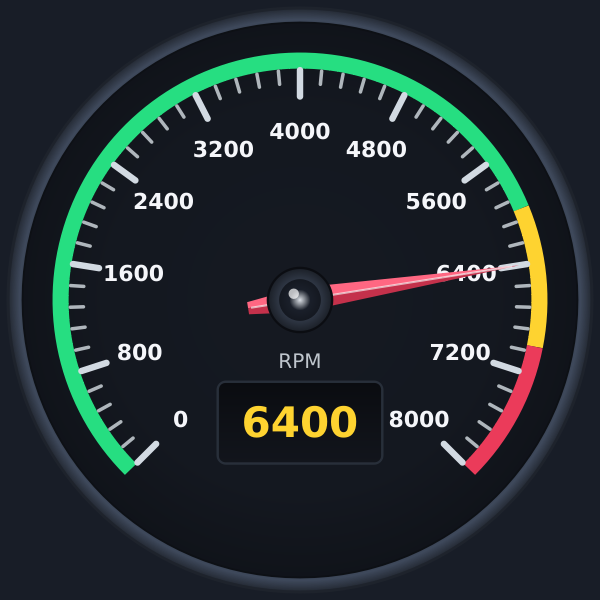

Circular gauge for speed, pressure, temperature and similar values (`qiw::RadialGauge`).
- **Sweep**: `startAngle` and `spanAngle` set the arc, for example 270°, 240° or 180°.
- **Scale**: `majorTicks` and `minorTicks`, with numeric labels at the major ticks.
- **Thresholds**: `warningThreshold` and `errorThreshold`, shown as coloured arc bands (`thresholdBandsVisible`);
  `warningExceeded(bool)` and `errorExceeded(bool)` report crossings.
- **Digital display**: optional (`digitalDisplayVisible`), with `precision` and `unit`; it is sized and placed clear
  of the scale labels and never covers the scale. The value is drawn at 7 pt or more, never cut nor shortened. The
  value has precedence over the labels (#43), the first and last ones included: a label the display would cut is not
  drawn. Without room the unit goes first, then the number; `---` and the triangle are always shown, so only a valid
  readout may disappear (#60): below `minimumSizeHint()`, a valid value with no room leaves the pod empty.
- **Minimum size** (#60): `minimumSizeHint()` depends on the configuration. It is computed from the widget font, the
  range, the precision, the major ticks, the angles, the unit and the visibility of the display, and it changes with
  them. From that size up, the state indicator is drawn at 7 pt or more clear of the scale, and the first and last
  labels are drawn (on a span where they lie on each other, the first one). It is never below 90 × 90 and never above
  `sizeHint()`; the widest scales may not keep both ends even there.
- **Rendering**: the static scale is cached in a pixmap and rebuilt on geometry or appearance changes; a value change
  redraws the needle and the display.
- **Value state** (#151): `valueState()` reports `Valid`, `Underrange`, `Overrange` or `Invalid` (the
  `QtIndustrialWidgets::ValueState` enum), with `valueStateChanged()`; `rawValue()` keeps the unclamped input, and a
  range change classifies it again. Before the first `setValue()` there is no input: the initial value (0) follows
  the range, so a range that does not hold 0 shows its minimum, in the `Valid` state.
  - An input outside the range (finite or ±Inf) puts the needle at the stop and `value()` at the bound. The display
    shows the input itself (for example `8350` on a 0–8000 scale), or `>max` / `<min` for ±Inf, after a triangle
    pointing up (above the range) or down (below it), so the state is not shown by colour alone.
  - A NaN input is `Invalid`: no needle, display `---`, `value()` NaN. The last valid value is not shown, and
    `warningExceeded()` / `errorExceeded()` are not emitted for an invalid input: use `valueStateChanged()` to
    detect it.

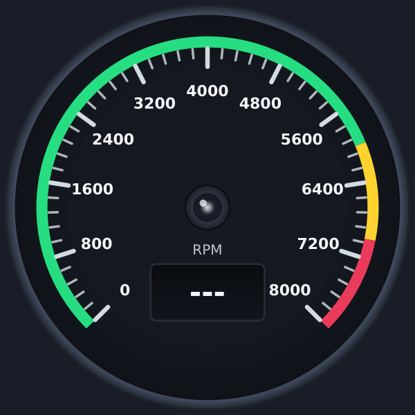

## LinearGauge

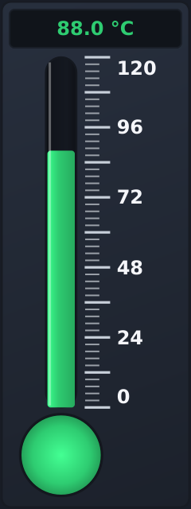

Bar gauge and thermometer (`qiw::LinearGauge`).
- **Orientation**: `Qt::Vertical` or `Qt::Horizontal`.
- **Thermometer mode** (`thermometerMode`): a bulb at the bottom (vertical) or on the left (horizontal); otherwise a
  plain bar.
- **Liquid colour**: fixed (`liquidColor`), following the warning and error thresholds (`dynamicLiquidColor`), or a
  gradient fill (`gradientLiquid`).
- **Scale and display**: major and minor ticks with labels (`scaleVisible`), optional digital display with `precision`
  and `unit`. On a horizontal gauge the end labels stay inside the scale; on a vertical one every label is centred on
  its tick, and the end labels move only to stay off the display and inside the widget (#37).
- **Value state** (#151): `valueState()` reports `Valid`, `Underrange`, `Overrange` or `Invalid`, with
  `valueStateChanged()`; `rawValue()` keeps the unclamped input, and a range change classifies it again. Before the
  first `setValue()` the initial value (0) follows the range, as in `RadialGauge`.
  - An input outside the range (finite or ±Inf) fills the tube to its end and puts `value()` at the bound. The
    display shows the input itself (for example `135.4 °C` on a 0–120 scale), or `>max` / `<min` for ±Inf, after a
    triangle pointing up (above the range) or down (below it), so the state is not shown by colour alone.
  - A NaN input is `Invalid`: the tube and the bulb are empty and hatched with diagonal lines in `scaleColor`, the
    display shows `---` and `value()` is NaN. The last valid value is not shown.

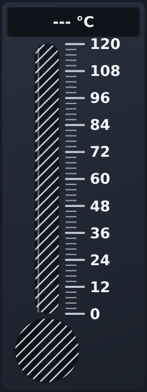

## SevenSegmentDisplay

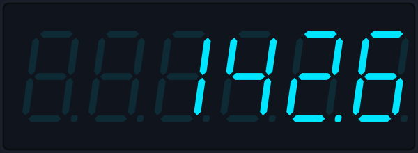

Vector seven-segment display for numeric readouts (`qiw::SevenSegmentDisplay`).
- **Vector segments**: the segments are painted as polygons and scale with the widget.
- **Format**: `digitCount`, `decimalPlaces`, `showLeadingZeros`, `showDecimalPoint`; a value that rounds to zero is
  shown without a minus sign.
- **Shape**: `skewAngle` (italic slant) and `segmentWidthRatio` (segment thickness).
- **Colours**: `activeSegmentColor` for lit segments and `inactiveSegmentColor` for unlit ones.
- **Text** (`setText()`): digits, `-`, `_`, `=`, space and the letter patterns A, b, C, c, d, E, F, H, L, o, P, r, U.
  Upper- and lower-case input give the same pattern, except `C`/`c` (two patterns) and `r` (lower case only); any
  other character is shown blank.

## LedIndicator

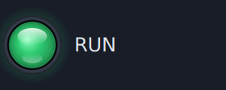

LED indicator lamp (`qiw::LedIndicator`).
- **Shape**: `LedShape::Circular` or `LedShape::Rectangular`, with an optional bezel (`bezelVisible`) and glow
  (`glowEffect`).
- **State**: `on`, with `toggle()`, and blinking (`blinking`) at `blinkRateMs`.
- **Label**: `labelText`, drawn in `textColor` (or the palette's window text colour when `textColor` is not set).
- **Interaction**: optional (`clickable`), emitting `clicked()`.

## IndustrialKnob

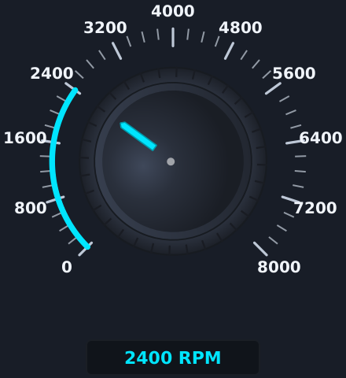

Rotary knob (`qiw::IndustrialKnob`).
- **Modes**: `KnobMode::Continuous` (any value in the range, with `step`) or `KnobMode::Discrete` (`discreteSteps`
  positions, for selectors).
- **Scale**: arc set by `startAngle` and `spanAngle`, major and minor ticks with labels, an active track
  (`trackVisible`) and a value display (`valueDisplayVisible`). Every tick is drawn; labels are drawn every k-th tick,
  with the smallest k that keeps the free space between them, in both modes (#60). The first and last labels are
  always drawn, unless they would overlap each other (an arc of about 360°): then the last one is left out.
- **Size** (#170): the dial is as large as the labels drawn allow: long labels make it smaller, down to half of the
  full radius, with the centre fixed, so that the pixels of the labels stay inside the widget. `minimumSizeHint()` is
  computed from the font, the configuration and the device pixel ratio, between 80 × 90 and `sizeHint()`: from that size up the labels drawn are inside the
  widget and the first and last ones are drawn, with the same exception.
- **Input** (the [rules for controls](#controls), #182): relative mouse drag, the keys arrows (`step`), PageUp/PageDown
  (`pageStep`, 5 × `step` until it is set), Home/End, and the mouse wheel when it is enabled (`wheelEnabled`, off by
  default; only with focus).
  - A press changes nothing. A left press on the dial as it is drawn (within the radius of its scale), on the scale,
    starts a drag. The value then moves by the angle the pointer moves around the centre of the dial.
  - A press in the gap between the ends of the scale, or outside the dial, starts no drag (#175).
  - During a drag the value stops at the end it reaches and never jumps to the other one: it moves again when the
    pointer is back on that end (#175).
  - `valueCommitted()` at the release of a drag or of a key, as in the rules.
  - Read-only (`readOnly`): the padlock is drawn at the centre of the cap, inside the inner end of the pointer, so the
    pointer is never covered at any angle.
  - Value limits (`setValueLimits()`): the band of the ticks is hatched outside them, and each limit inside the range
    has a radial stop mark longer and thicker than a tick. Past a limit a drag holds the value there until the pointer
    comes back, as at an end of the scale. In Discrete mode the operator reaches only the steps inside the limits:
    Home/End go to the first and last of them.
- **Focus and accessibility** (the [rules for controls](#controls), #183): a solid focus ring in `textColor`, just
  outside the grip. Accessible role `Dial`; the value text is the readout, `POS n` in Discrete mode; the step is
  `step` in Continuous mode and the size of a detent in Discrete mode.
- **Rendering**: the knob has a serrated grip of 32 teeth; ticks and scale are cached, so a rotation redraws only the
  moving parts.
- **Non-finite input** (#151, #182): the knob is an input control and has no value state. `setValue()` rejects NaN and
  ±Inf with a warning: the knob keeps its position.

## IndustrialSlider

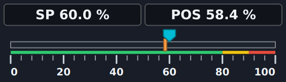

Linear setpoint control with position feedback (`qiw::IndustrialSlider`, #180): the command to an actuator (a valve, a
damper, a speed reference) and the position the actuator reports, on one scale.
- **Scale**: `orientation` (`Qt::Horizontal` by default; vertical with the maximum at the top), `minimum` and
  `maximum`, `majorTicks`, `minorTicks`, `precision`, `unit`, and the zones of `warningThreshold` and
  `errorThreshold` (NaN, the default, disables a threshold). The labels follow the rules of `LinearGauge`.
- **Setpoint**: a handle with its tip on the track. `setSetpoint()` takes a finite value and clamps it to the range;
  NaN and ±Inf are rejected with a warning and the setpoint stays unchanged.
- **Feedback**: a bar across the track, on the other side of it from the handle, so that the two do not rely on
  colour. A new slider has no feedback (`hasFeedback()` is false) and draws no bar, no position readout and no
  deviation; `setFeedback()` gives it one, `clearFeedback()` removes it. The input is classified as for the gauges
  (#151, `feedbackState`): out of range or ±Inf the bar stops at the end of the scale with a triangle past it; NaN
  draws no bar, hatches the track and reads `---`. The last valid position is never shown.
- **Deviation**: with a feedback and `deviationThreshold` above 0 (0 or NaN turns it off, the default),
  `deviationState` is `Off`, `Unknown` (the feedback is NaN or ±Inf; never `Normal`), `Normal` or `Deviating`
  (|setpoint − feedback| above the threshold, with a feedback outside the range taken as it is). `Deviating`
  cross-hatches the track between the handle and the bar and puts an outlined Δ in the position readout; `Unknown`
  puts a `?` there. The feedback lags the setpoint, so every change of the setpoint larger than the threshold shows
  `Deviating` until the actuator reaches it: an application that raises an alarm on the deviation must filter it.
- **Readouts**: the setpoint (`SP`) and the position (`POS`, `feedbackReadoutVisible`) on opaque panels in
  `readoutColor` (#159). Never below 7 pt; without room the unit goes first, then the number, never the tag, the Δ or
  `?` mark, the triangle, `---` or the padlock. `minimumSizeHint()` is computed from the font and the configuration.
- **Input** (the [rules for controls](#controls), #182): a drag of the handle, relative (a press on the track or the
  scale does nothing); Left/Down and Right/Up by `step`, PageDown/PageUp by `pageStep`. Home/End go to the limits;
  from outside the limits, a key that would move the setpoint further out is ignored. The mouse wheel when it is
  enabled (`wheelEnabled`, off by default; only with focus).
  - Read-only (`readOnly`): the padlock is drawn before `SP` in the setpoint readout.
  - Setpoint limits (`setSetpointLimits()`): the band of the ticks is hatched outside them, and each limit inside the
    range has a stop mark across the zone band and the ticks.
- **Focus and accessibility** (the [rules for controls](#controls), #183): a solid 2 px focus ring in `textColor`
  along the edge of the widget. Accessible role `Slider`; the value of the value interface is the setpoint, with the
  range and `step`. The value text has the setpoint, the position and the deviation state, in words rather than the
  marks of the readouts: `60.0 %, position 15.0 %, deviation`; `60.0 %, position invalid, deviation unknown` for a NaN
  feedback; `position over range 120.0 %` or `position under range` (±Inf has no number) outside the range; the
  position is left out without a feedback, and the deviation when it is `Off` or `Normal`. Value-change events follow
  the setpoint and the range; a change of the feedback or of the deviation sends none. Known limitation: assistive
  technology reads the position and the deviation from the value text only, since the Qt value interface has a single
  value, the setpoint.

## StripChart

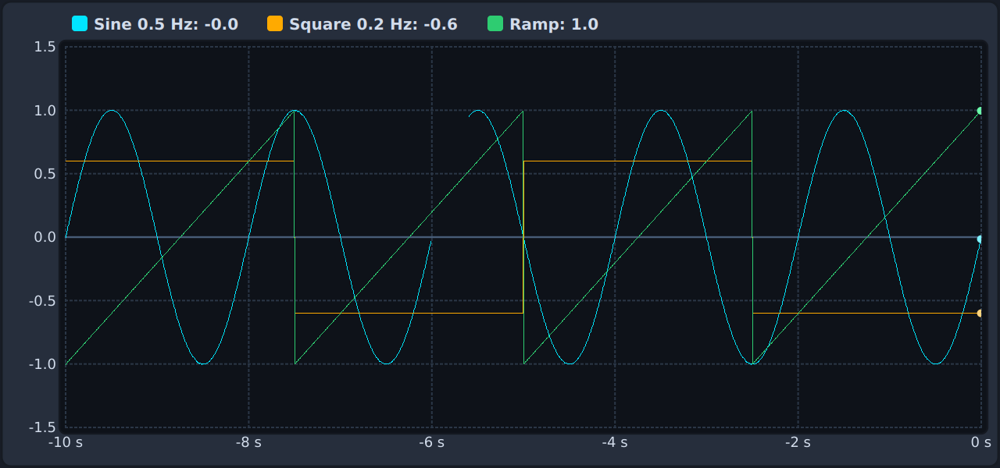

Live, scrolling multi-channel chart for acquisition data (`qiw::StripChart`). Guide: [strip_chart.md](strip_chart.md).
- **Time axis**: `std::chrono::nanoseconds` timestamps, 1-2-5 tick steps, labels relative (`-10 s … 0 s`) or absolute
  wall-clock time (`HH:mm:ss.zzz`); a sample-index axis is also available.
- **M4 decimation**: with more samples in the window than device pixel columns, each column draws the first, minimum,
  maximum and last sample of its bucket (at most 4 vertices per column per channel), with a cosmetic 1-device-pixel pen
  without antialiasing. Buckets are anchored to absolute time (or sample index), so they keep their contents while the
  window scrolls. Peaks are kept, except in a column that holds a non-finite sample: that column is left blank so a
  dropout stays visible.
- **Gaps and dropouts**: a non-finite value breaks the trace, and so does a time gap larger than `gapThreshold`
  (default: 4 × an exponential moving average of the sampling interval).
- **Autoscale**: optional; the range grows at once to include new values and shrinks only after 30 consecutive
  recomputations in which the data spans less than half of it.
- **Channels**: independent channels with name, colour, pen width and visibility, and a legend (`legendVisible`).
- **Performance**: measured paint and insertion times, with the targets and their results, are in the
  [Benchmark Report](benchmarks.md).

## IndustrialSwitch

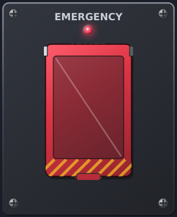

Toggle or rocker switch (`qiw::IndustrialSwitch`).
- **Types**: `SwitchType::ToggleLever` or `SwitchType::Rocker`.
- **Positions**: 2 (`labelOff` / `labelOn`) or 3 (`labelOff` / `labelCenter` / `labelOn`), via `positionCount`.
- **Safety guard**: optional cover (`hasSafetyGuard`) that has to be opened (`isGuardOpen`, `guardToggled(bool)`)
  before the switch can be operated.
- **Orientation**: `Qt::Vertical` or `Qt::Horizontal`.
- **Details**: optional status LED (`hasLed`), animated movement (`animated`), mouse click and drag, and the keys
  Space, Return and the arrows.
- **Focus** (#183): the switch takes focus with Tab, Shift+Tab and a click, also with the guard closed. While it has
  focus it draws a solid 2 px ring in `textColor`, the colour of the labels on the plate, along the inside of the
  plate (2.25 to 4.25 px in from its edge, between the bevel and the corner screws): at least 3:1 against the plate in
  both gallery themes (`tests/tst_ReadoutContrast.cpp`). Where a label, the LED or the open guard comes into that
  band (the centre label of a vertical 3-position switch reaches 1 px from the edge), the ring leaves a gap 1 px
  around it, so it never covers them. The ring changes neither the layout nor the size hints.
- **Accessibility** (#183), with the general notes in [Controls](#controls):

  | | 2 positions | 3 positions |
  |---|---|---|
  | Role | `CheckBox`, checkable, checked in the ON position | `Slider` |
  | Value text | the label of the position (`labelOff` / `labelOn`) | `labelOff` / `labelCenter` / `labelOn` |
  | Value | — | the position, 0 to 2, step 1 |
  | Actions | toggle (as Space) | increase, decrease (as the arrows) |
  | Event at every change of position | state change (checked) | value change |

  - A label left empty gives the number of the position as value text.
  - **Name**: `accessibleName()`, otherwise the title (`label()`). A change of the title that serves as name is
    notified. The gallery switches all have a title.
  - **Guard**: while it is closed the switch is read-only for assistive technology, and its only action of its own is
    "Open guard"; open, it also has "Close guard". The actions and a value set by assistive technology follow the
    guard like the keys: they move nothing while it is closed. A state-change event (read-only) is sent when the guard
    opens, closes or is fitted.
  - The role follows `positionCount`, and Qt has no event for a change of role: set `positionCount` before the switch
    is shown, or a screen reader may keep the old role until the focus moves.

## LevelMeter

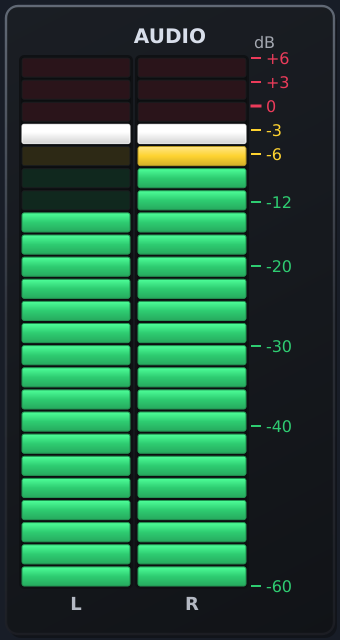

Multi-channel level meter (`qiw::LevelMeter`).
- **Channels**: any number (`channelCount`), with labels (`setChannelLabels()`).
- **Display**: `DisplayMode::Segmented` (LED segments, `segmentCount`) or `DisplayMode::Continuous` (bar).
- **Zones**: normal, warning and error, set by `warningThreshold` and `errorThreshold`; `overloadOccurred(int)` reports
  a channel entering the error zone.
- **Peak hold**: optional (`peakHoldEnabled`), held for `peakHoldTimeMs`, then falling at `peakDecayRate` units per
  second.
- **Orientation and scale**: vertical or horizontal, optional scale (`scaleVisible`) with a `unit` such as dB.
- **Value state, per channel** (#151): `valueState(int)` reports `Valid`, `Underrange`, `Overrange` or `Invalid`, with
  `valueStateChanged(int, ValueState)`; `rawValue(int)` keeps the unclamped input, and a range change classifies it
  again. Before the first `setValue()` of a channel its initial value follows the range. A channel that does not
  exist reports `Invalid` and a NaN `rawValue(int)`; its `value(int)` stays `minimum()` for compatibility.
  - An input outside the range (finite or ±Inf) fills the bar to its end and puts `value(int)` at the bound. On a dB
    scale, -Inf (digital silence) stays at the minimum, with the state `Underrange`.
  - A NaN input is `Invalid`: the bar is empty and hatched with diagonal lines in `textColor`, the peak marker is
    hidden, and `value(int)` and `peakValue(int)` are NaN. The last valid value is not shown. A NaN never signals an
    overload; the first valid value after it starts a new peak, and signals an overload if it is in the error zone.

## AnnunciatorPanel

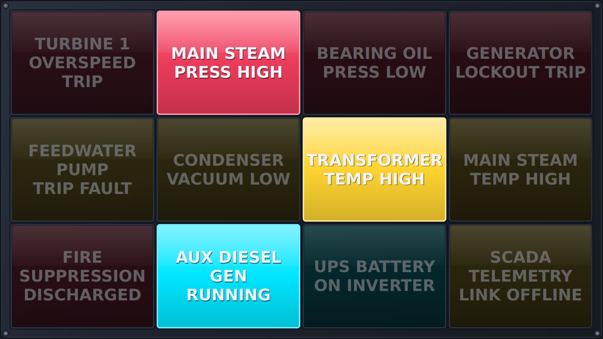

Alarm annunciator grid with automatic-reset and manual-reset sequences (`qiw::AnnunciatorPanel`).
- **Grid**: `rows` × `columns` tiles, each with a text and a severity (`Severity::Critical`, `Warning` or `Advisory`).
- **Sequences**: `SequenceA_AutomaticReset` and `SequenceM_ManualReset`, with the states `Normal`, `Unacknowledged`
  (fast flash), `Acknowledged` (steady) and `Ringback` (slow flash).
- **Operator actions**: `acknowledge()` / `acknowledgeAll()`, `silence()`, `reset()` / `resetAll()` and
  `setLampTest()`; `audibleHornChanged(bool)` reports the horn state. Clicking an unacknowledged tile acknowledges it
  (`tileClicked(int)`).

## Compass

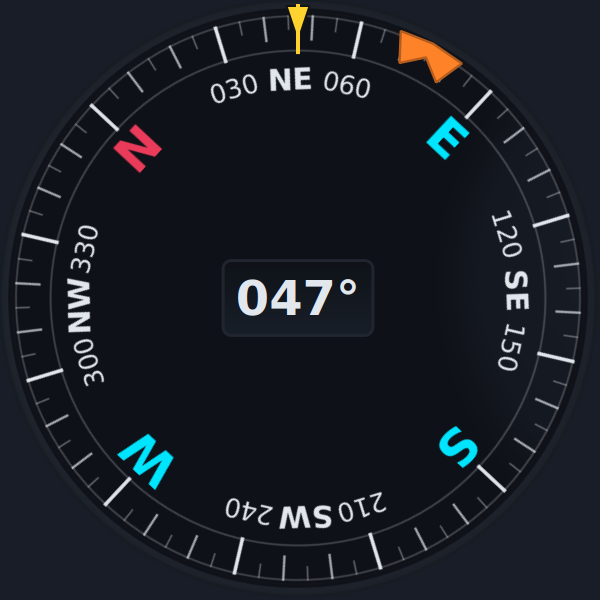

Heading indicator (`qiw::Compass`).
- **Modes**: `DisplayMode::HeadingUp` (the card rotates with the heading) or `DisplayMode::NorthUp` (fixed card,
  rotating needle).
- **Heading bug**: target heading (`targetHeading`), optionally set with the mouse (`headingBugInteractive`); the
  difference from the heading is `courseDeviation`.
- **Card**: cardinal (N, E, S, W) and intercardinal (NE, SE, SW, NW) labels and three-digit degree numbers.
- **References**: lubber line (`lubberLineVisible`) and digital heading readout (`digitalReadoutVisible`).
- **Value state** (#151): a heading has no range, so `valueState()` is only `Valid` or `Invalid`, with
  `valueStateChanged()`. NaN and ±Inf have no direction: `heading()` and `courseDeviation()` are NaN, a red `HDG`
  failure flag is drawn on the dial and the readout shows `---°`. North-up draws no needle and keeps the lubber
  line, which marks the fixed north of its card, not the heading; heading-up draws the card at 0° with dimmed
  colours and no lubber line, so that it is not read as a heading of 000, and dims the heading bug with it (its
  place from 12 o'clock would read as a course deviation). A non-finite target heading is ignored.

## CircularBargraph

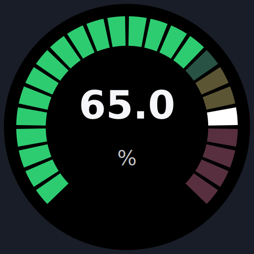

Bargraph of curved segments on an arc (`qiw::CircularBargraph`).
- **Modes**: `DisplayMode::Bar` (segments lit up to the value) or `DisplayMode::Dot` (one segment).
- **Geometry**: arc set by `startAngle` and `spanAngle` (e.g. 180°, 270° or 360°), `segmentCount` segments.
- **Threshold zones by position**: each segment takes the colour of the zone (normal, warning, error) containing its
  centre; unlit segments show a dimmed tint of their zone over `ghostColor`. The setters keep
  `warningThreshold <= errorThreshold`.
- **Peak hold**: optional, held for `peakHoldTimeMs`, then decaying at `peakDecayRate`.
- **Digital display**: optional, with `precision` and `unit`, in a round pod inside the arc. The value is drawn at
  7 pt or more and never cut nor shortened; what does not fit in the pod is left out, the unit first, then the
  number (#167). `---` and the triangle are always shown, so only a valid readout may disappear.
  `minimumSizeHint()` is the smallest size at which `---` and the triangle fit in the pod at 7 pt, computed from the
  widget font. At that size the state indicator is always visible and the number appears only if there is room: the
  room depends on the font and on the length of the text (range, precision, input). A larger widget is needed to
  show the whole readout.
- **Value state**: `valueState()` reports `Valid`, `Underrange`, `Overrange` or `Invalid`. Out-of-range inputs
  (including ±Inf) are shown at the range bound with the end segment blinking; the readout follows the common rule
  above (`▲ 120.0`, `>100.0` for +Inf). A NaN input is shown as `Invalid` (all segments unlit, readout `---`).
  `rawValue()` keeps the unclamped input.

## TankDisplay

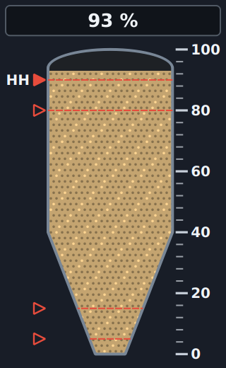

Level indicator for tanks and silos (`qiw::TankDisplay`, #152).
- **Vessel**: `shape` is `TankShape::VerticalCylinder`, `HorizontalCylinder`, `Hopper` (a cylinder with a conical
  bottom) or `Sphere`; `content` is `Content::Liquid` (a flat fill) or `Content::Granular` (a fill with a grain
  texture). The vessel keeps the proportions of its shape and is centred in the space left by the readout, the scale
  and the limit tags.
- **Scale and fill**: the scale runs from the bottom of the vessel (`minimum`) to its top (`maximum`), with
  `majorTicks`, `minorTicks` and labels that keep a minimum gap. The fill height is linear in the value. The widget
  converts nothing: it shows the value the application passes, on the scale the application sets. In a horizontal
  cylinder or a sphere the volume is not linear in the height, so a volume scale would put the surface at the wrong
  height there: pass the level (in % or in m) instead.
- **Limits**: `lowLowLimit`, `lowLimit`, `highLimit`, `highHighLimit`, each disabled by NaN (the default). The enabled
  limits must keep `lowLow ≤ low < high ≤ highHigh`; `setLimits()` and the single setters reject a change that breaks
  the order, or a limit of ±Inf, and change nothing: `setLimits()` returns `false`, a single setter (and a property
  write) emits a `qWarning()` that names the limit and the reason.
- **Limit state**: `limitState()` is `Unknown`, `Normal`, `Low`, `LowLow`, `High` or `HighHigh`, with
  `limitStateChanged()`. It is computed on the input, not on the value shown, so +Inf gives `HighHigh` when that
  limit is enabled. A high limit is entered at `input >= limit` and left below `limit − limitHysteresis`; a low limit
  is entered at `input <= limit` and left above `limit + limitHysteresis` (default hysteresis 0). A NaN input gives
  `Unknown`, never `Normal`.
- **Markers**: each enabled limit inside the range has a dashed line across the vessel and a triangle on its left;
  the triangle of the limit in force is filled and tagged `HH`, `H`, `L` or `LL`, so the state is not told by colour
  alone. A limit outside the range has no marker while it is not in force; in force, its filled and tagged triangle
  stands at that end of the scale, with a small triangle past it pointing away from the scale (the limit lies beyond
  it). So every limit state other than `Normal` and `Unknown` is visible. The widget only shows and reports the
  limits: acknowledgement and latching stay in the application.
- **Readout**: optional, above the vessel, on an opaque panel in `readoutColor()` (#159). The text is never below
  7 pt; without room the unit goes first, then the number, never the triangle or `---`. `minimumSizeHint()` is
  computed from the font, the logical DPI and the configuration (shape, scale labels, limit tags, readout).
- **No value until the first `setValue()`**: unlike the gauges, which start at their minimum as `Valid`, a new
  `TankDisplay` starts `Invalid` (`value()` and `rawValue()` NaN, the vessel hatched, the readout `---`) with
  `limitState()` `Unknown`, so that a level that was never read is never shown as a level.
- **Value state**: as the other gauges (#151). Out-of-range inputs and ±Inf fill to the end of the scale and the
  readout shows the input after a triangle; a NaN input empties the vessel, hatches it and shows `---`.
- **Colours**: `contentColor`, `vesselColor` (the wall; the empty inside is a dark shade of it in every theme),
  `scaleColor`, `textColor`, `readoutColor`, `limitColor`. The content colour carries no meaning of its own. The
  hatch of an invalid input is derived from the inside, mixed toward white or black (whichever contrasts more) up to
  4.5:1 against it, so it keeps at least 3:1 (WCAG 2.x, graphical objects) for any `vesselColor`. The limit lines
  are aligned to device pixels, so they reach their colour at every device pixel ratio.
- **Contrast is guaranteed only for the hatch**, which the library computes. `contentColor` and `limitColor` are
  drawn on the inside as given: whoever changes `vesselColor` (and so the inside) or these colours must check
  their contrast against the inside (3:1 for graphical objects). For example, with `vesselColor` (235, 235, 235)
  the inside is (59, 59, 59), and the default `limitColor` measures 2.93:1 against it.

## ValveIndicator

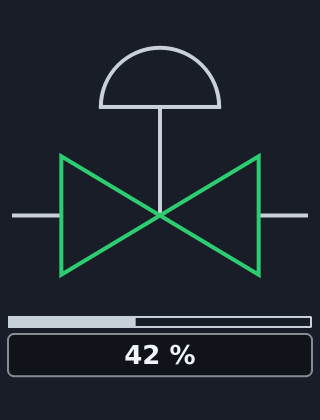

Valve symbol that shows the status of a valve and, optionally, its opening (`qiw::ValveIndicator`, #153). An
indicator only: it shows what the application tells it and sends no command.
- **Symbol**: the symbols follow common P&ID practice. `valveType` is `ValveType::Gate` (two triangles tip to tip),
  `Ball` (with a circle at the centre), `Butterfly` (with a line through the centre, the disc) or `Control` (with a
  stem and a diaphragm actuator). `orientation` is `Qt::Horizontal` (flow from left to right, actuator on top) or
  `Qt::Vertical` (flow from the top down, actuator on the right). `pipeStubsVisible` adds a short pipe on both
  sides (off by default).
- **Status**: `status` is told by the shape first, the colour second, so no status depends on colour (#167):
  - `Unknown` (the default of a new widget): the body hatched with diagonal lines, and a `?` tag;
  - `Closed`: the body filled;
  - `Open`: the body outlined, empty;
  - `Transit`: the upstream half of the body filled, and a dashed outline;
  - `Fault`: a cross over the body, and a `FAULT` tag.
- **Opening**: `opening` (0 to 100 %) is shown by an opening bar and a readout under the symbol. A control valve
  always shows them; the other types show them when `openingVisible` is true (false by default). The input is
  classified as for the gauges (#151): `rawOpening` keeps it, `openingState` is its `ValueState`. Out of range or
  ±Inf, the bar stops at the bound and the readout shows the input after a triangle; NaN gives no bar and `---`. A
  new `ValveIndicator` has no opening: it starts `Invalid` until the first `setOpening()`. The readout is on an
  opaque panel in `readoutColor` (#159), never below 7 pt; without room the unit goes first, then the number, never
  the triangle or `---`. `precision` sets its decimals (default 0).
- **Status and opening are independent**: the widget never derives one from the other. It shows, for example, a
  `Closed` status with a 40 % opening if it is told so; keeping them consistent is the application's job.
- **Colours**: `openColor`, `closedColor`, `transitColor`, `faultColor` and `unknownColor` draw the body in each
  status; `outlineColor` the stubs, the marks of the type and the opening bar; `textColor` the status tags;
  `readoutColor` the readout. The default status colours are only a default choice: the conventions for open and
  closed differ between sectors (green for open and red for closed in some, the reverse in others), so pick the
  colours of the plant. The meaning is carried by the shape, never by the colour alone. The library checks the
  contrast of the readout (4.5:1 against its panel) and of the status tags in the gallery styling
  (`tests/tst_ReadoutContrast.cpp`); the status colours are drawn as given, so whoever changes them or the
  background must check their contrast (3:1 for graphical objects). On white the default open, transit and unknown
  colours are below 3:1 (2.10, 1.66 and 2.56:1); the light theme of the gallery uses the same hues, darker:
  (36, 160, 89), (170, 138, 10) and (125, 145, 146).
- **Size**: `minimumSizeHint()` is computed from the font, the logical DPI and the configuration (type,
  orientation, stubs, opening), and follows a change of screen (#177). The status and the opening do not change it.

## AnalysisChart

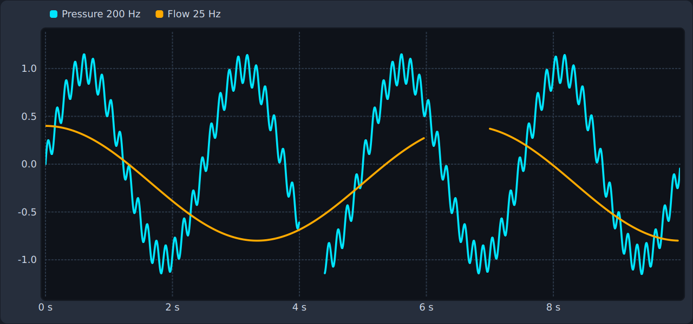

Offline review of recorded multi-channel data (`qiw::AnalysisChart`). Guide: [analysis_chart.md](analysis_chart.md).
- **Recorded data**: per-channel copies of absolute `std::chrono::nanoseconds` timestamps and `double` values, at
  different or irregular rates; decreasing timestamps are rejected and the previous data kept.
- **Zoom and pan**: wheel zoom around the pointer (Ctrl+wheel for values), drag to pan, box zoom, keyboard navigation,
  double-click or Home to reset.
- **Cursors**: two cursors with nearest-sample readouts (no interpolation), Δt and Δy, in a readout band of up to 6
  channels that is part of the minimum size.
- **Same rules as StripChart**: non-finite values and time gaps break the trace, and M4 decimation draws one bucket
  per device column with dropout columns left blank; a min/max pyramid built by `setChannelData()` (at most 2.125
  bytes per sample on top of the 16 of the data) supplies the buckets.
- **Performance**: the target of #25 (redraw after a zoom or pan step ≤ 16.7 ms for 4 channels × 10 M samples at
  1920 px) is not met; tables, method and cause in the
  [Benchmark Report](benchmarks.md#analysischart-performance-benchmarks).
